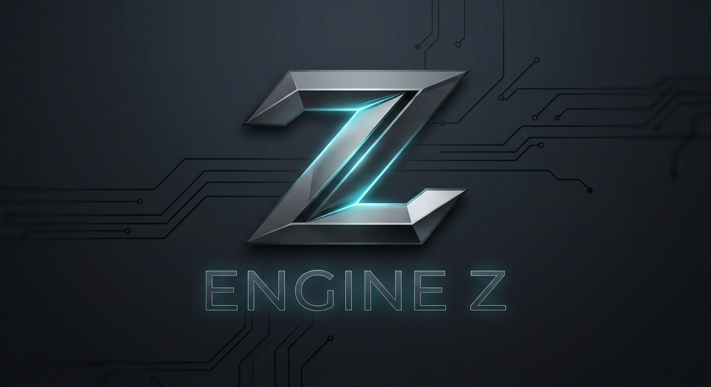

# Engine-Z



Engine Z is a C++20 game engine for 2D and 3D games, built with CMake. 
Windows is the primary platform, with Linux and macOS kept possible.

* [Architecture](Docs/Architecture.md): how the codebase is organised and the rules it follows.
* [Extending Engine Z](Docs/Extending.md): how to add code, games and libraries.

## Building

Requirements: Visual Studio 2022 with the Desktop development with C++ workload (including the C++ CMake tools for Windows), Git, and CMake 3.25 or newer.

No download step is needed, because SDL is vendored. The first build compiles all of SDL, so it is slower than later builds.

In Visual Studio:

1. File > Open > Folder, and pick the repo root.
2. Project > Configure Cache. Check View > Output with the CMake source selected.
3. Choose `Sandbox` in the toolbar's Startup Item dropdown and run with Ctrl+F5.

From the command line, in the repo root:

```
cmake -S . -B build
cmake --build build
```

On Linux, SDL needs some system packages (X11 or Wayland development libraries) before it configures. The list is in `Engine/ThirdParty/SDL3/docs/README-linux.md`.

Build folders:

* `build/` is used by the command line. `out/` is Visual Studio's default. Both are generated, ignored by Git, and safe to delete.
* A build folder remembers the generator it was configured with. Do not share one folder between tools, and delete it after changing generator or Visual Studio version.
* If Visual Studio does not configure CMake when the folder opens, close it, delete the hidden `.vs` folder in the repo, and reopen the folder.